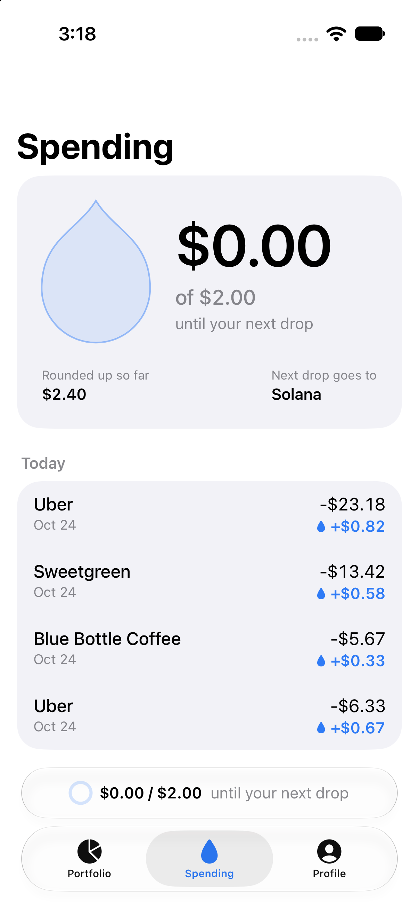
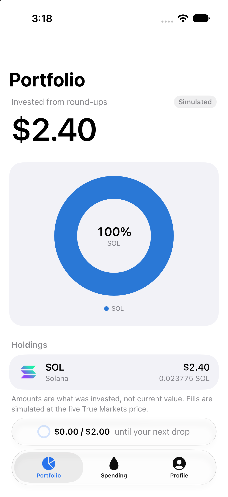
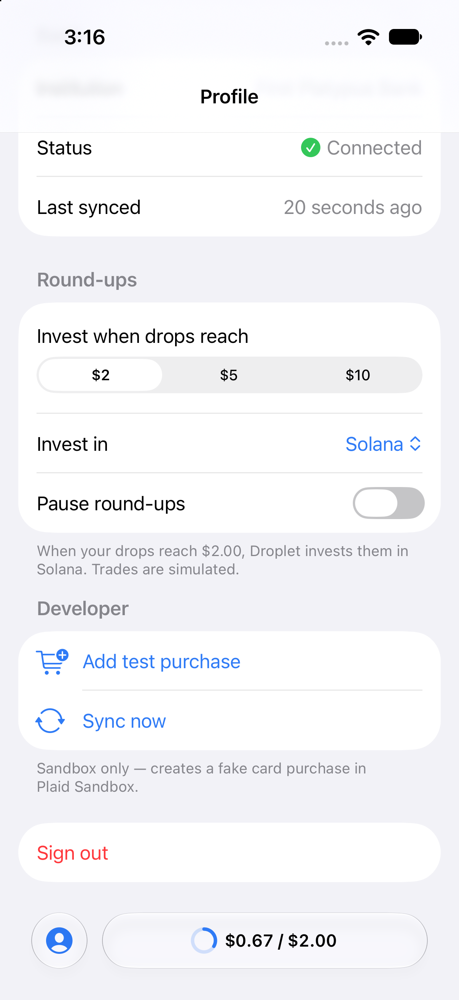

# Droplet

Round up every purchase. Your spare change becomes drops, and drops become crypto.

Droplet links a bank with **Plaid** (Sandbox) and rounds every settled purchase up to the next dollar. When your drops reach your threshold ($2 / $5 / $10), it records a **simulated** investment in the asset you choose, priced from **True Markets**' live public price feed. No real trades are placed.

<p align="center">
  
  
  
</p>

## Stack
- iOS 26+ SwiftUI app (`ios/`, generated with XcodeGen), using supabase-swift and Plaid LinkKit 7
- Supabase backend (`supabase/`): Postgres + RLS, six Deno Edge Functions, pg_cron + pg_net

## Run locally
1. `brew install supabase/tap/supabase xcodegen deno xcbeautify`, and start Docker.
2. `cp supabase/functions/.env.example supabase/functions/.env`, then fill in your Plaid **Sandbox** client id and secret and a random `CRON_SECRET`. Leave `PLAID_WEBHOOK_URL` empty locally.
3. `supabase start && supabase db reset && supabase test db`
4. `supabase functions serve --env-file supabase/functions/.env`
5. `scripts/make-ios-config.sh && cd ios && xcodegen generate && open Droplet.xcodeproj`, then run on an iPhone simulator.
6. Sign up, connect **First Platypus Bank** with `user_good` / `pass_good`, then use **Profile → Add test purchase**.

`scripts/make-ios-config.sh` writes `ios/Droplet/Resources/Config.xcconfig` (gitignored) from `supabase status`. Without arguments it points the app at the local stack.

## Tests
- Database (pgTAP, needs `supabase start`): `supabase test db`
- Edge Functions: `cd supabase/functions && deno task test`. The one database-backed suite (`store.integration.test.ts`) is skipped unless you run it against the local stack with `DROPLET_DB_TESTS=1`.
- iOS: `cd ios && xcodebuild test -project Droplet.xcodeproj -scheme Droplet -destination 'platform=iOS Simulator,name=iPhone 17' | xcbeautify`

## Deploy to a hosted Supabase project
The hosted backend for this build is project ref `nepouyikmncsxgavwedi`, at `https://nepouyikmncsxgavwedi.supabase.co`. To deploy to your own project, replace the ref. Never paste secret values into a terminal transcript or commit them.

```bash
export REF=nepouyikmncsxgavwedi
supabase login                              # once, or export SUPABASE_ACCESS_TOKEN
supabase link --project-ref "$REF"          # prompts for the database password
```

1. **Database and auth config.** `supabase db push` applies the four migrations. Then run `supabase config push` and answer each prompt per service: **auth: yes** (this turns `enable_confirmations` off, so email confirmation is not required), **storage: no** (Droplet does not use Storage). Do not use `--yes`.
2. **Function secrets.** Copy your local `.env`, point the webhook at the hosted function, and set the secrets from the file:
   ```bash
   ENVFILE="$(mktemp)"
   grep -v '^PLAID_WEBHOOK_URL=' supabase/functions/.env > "$ENVFILE"
   echo "PLAID_WEBHOOK_URL=https://$REF.supabase.co/functions/v1/plaid-webhook" >> "$ENVFILE"
   supabase secrets set --env-file "$ENVFILE" --project-ref "$REF" && rm -f "$ENVFILE"
   ```
3. **Functions.** Deploy them by name:
   ```bash
   supabase functions deploy plaid-link-token plaid-exchange plaid-sync plaid-webhook sync-all simulate-purchase --project-ref "$REF"
   ```
   `plaid-webhook` and `sync-all` have `verify_jwt = false` in `supabase/config.toml`, because Plaid and pg_cron call them without a user JWT. They check a Plaid signature and the `x-cron-secret` header instead. Calling `sync-all` without that header should return `{"error":{"code":"UNAUTHORIZED",...}}`:
   ```bash
   curl -s -X POST "https://$REF.supabase.co/functions/v1/sync-all" -H 'Content-Type: application/json' -d '{}'
   ```
4. **Cron.** The `droplet-sync-all` job (every 15 minutes) does nothing until its two Vault secrets exist. `droplet_cron_secret` must equal `CRON_SECRET`:
   ```bash
   CRON_SECRET=$(grep '^CRON_SECRET=' supabase/functions/.env | cut -d= -f2-)
   supabase db query --linked "select vault.create_secret('https://$REF.supabase.co/functions/v1', 'droplet_functions_url'); select vault.create_secret('$CRON_SECRET', 'droplet_cron_secret');" >/dev/null && echo stored
   supabase db query --linked "select jobname, schedule, active from cron.job where jobname = 'droplet-sync-all';"
   ```
   Expect a row `droplet-sync-all | */15 * * * * | t`.
5. **Point the app at the hosted project.** The publishable key is public by design. Get it with `supabase projects api-keys --project-ref "$REF"` (or Dashboard → Project Settings → API Keys), then:
   ```bash
   SUPABASE_URL="https://$REF.supabase.co" SUPABASE_PUBLISHABLE_KEY="<publishable key>" scripts/make-ios-config.sh
   ```
   Rebuild the app, sign up, link `user_good`, and add a test purchase. Webhook deliveries show up with `supabase functions logs plaid-webhook --project-ref "$REF"`, or in Dashboard → Edge Functions → plaid-webhook → Logs.

## Known limitations
- **Trades are simulated.** The True Markets private key is not used. Fills are recorded at the live public True Markets price, and the Portfolio screen shows the amount invested, not current value.
- **Plaid Sandbox rate-limits test purchases** (about 3 per minute on `sandbox/transactions/create`). Droplet maps this to a `429 RATE_LIMITED` response and the app shows "Plaid Sandbox allows only a few test purchases per minute. Wait a moment and try again." Wait a minute and retry.
- **Reconnect creates a new Plaid Item.** Reconnecting a bank replaces the stored item, resets the sync cursor, and resets the "linked on" date to today. The old Item is not removed from Plaid.
- **Only crypto is offered.** True Markets tokenized stocks are geo-blocked for US callers (stock orders return `403`), so the asset picker lists crypto only: SOL, ETH, CBBTC, AAVE, JUP and RENDER.

## Security
- The Plaid secret and access tokens never leave the server. `plaid_items` has RLS with no client policies.
- The app only holds the Supabase URL and the publishable key.
- The True Markets key is **not used**: trades are simulated until live trading is added.
